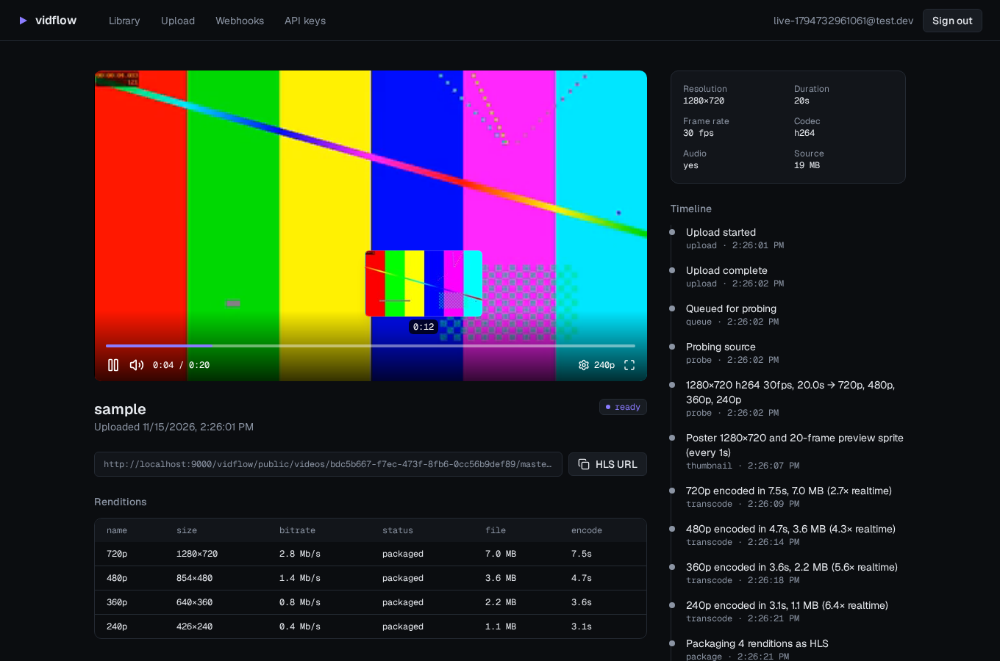

# Vidflow

A scalable video transcoding pipeline built from microservices and BullMQ.
Upload a video from the browser; it's probed, encoded into an adaptive bitrate
ladder, packaged as HLS, given a poster and scrub previews, and played back
from a CDN, with live progress in the dashboard and signed webhooks for your
own systems.



## Features

- **Resumable direct uploads**: multi-gigabyte files go from the browser
  straight to S3/R2 in parallel parts; close the tab and resume later
- **Adaptive streaming**: H.264/AAC ladder (1080p → 240p, never upscaled,
  portrait-aware), fMP4 HLS with aligned 2-second segments
- **Player**: hls.js with a quality menu and sprite-sheet scrub previews
- **Live progress** over server-sent events; per-video job timeline
- **Webhooks**: `video.uploaded/processing/ready/failed`, HMAC-signed, retried,
  with a delivery log; SSRF-safe
- **API keys** for uploading from your own servers
- **Reliability**: retries with backoff, stall recovery, dead-letter queue with
  replay, cancel and delete mid-flight, per-user rate limits, chaos-tested
- **Observability**: JSON logs, Prometheus metrics, alert rules, Grafana dashboard
- **Deployment**: one image per service, Compose + Caddy (HTTPS), R2 + CDN,
  queue-depth autoscaling (Compose script or KEDA), load test

## Stack

TypeScript monorepo (Turborepo, pnpm) · Next.js 16 · Hono · Better Auth ·
Drizzle + Postgres · BullMQ 6 + Redis · FFmpeg · S3 API (Cloudflare R2, AWS S3,
RustFS) · hls.js · pino · Prometheus · Grafana · Caddy · Docker

## Quick start

Needs Node 22, pnpm 10, Docker and FFmpeg.

```bash
cp .env.example .env
pnpm install
pnpm run setup    # Postgres, Redis and RustFS in Docker, migrations, bucket
pnpm dev          # web :3000, API :4000, all five workers
```

Open http://localhost:3000, sign up, upload a video.

| Command              | Does                                              |
| -------------------- | ------------------------------------------------- |
| `pnpm test`          | Unit and integration tests against real services  |
| `pnpm test:chaos`    | Kills a transcode worker mid-encode; must recover |
| `pnpm load-test`     | Uploads N videos and reports time-to-ready        |
| `pnpm queues:stats`  | Job counts per queue (`--watch`)                  |
| `pnpm queues:replay` | Lists or retries dead letters                     |
| `pnpm autoscale`     | Scales transcode workers with the queue (Compose) |
| `pnpm smoke`         | Starts the built API and checks `/health`         |

## Layout

```
apps/
  api/               Hono API: auth, uploads, videos, webhooks, keys, SSE, metrics
  web/               Next.js: upload, library, player, webhooks, API keys
  probe-worker/      ffprobe, rendition ladder, starts the flow
  transcode-worker/  FFmpeg encode per rendition
  package-worker/    HLS segments + master playlist, video ready
  thumbnail-worker/  poster, sprite sheet, WebVTT
  notify-worker/     webhook fan-out and delivery, maintenance
packages/            shared, db, storage, queues, media, observability, worker-runtime, test-utils
deploy/              Caddy, Kubernetes (KEDA), Prometheus + Grafana
docker/Dockerfile    every image
tests/               chaos and load tests
docs/                architecture, deployment, one folder per chapter
```

## Documentation

- [Architecture](docs/ARCHITECTURE.md): diagrams, packages, key decisions
- [Deployment](docs/DEPLOYMENT.md): R2, Compose, autoscaling, monitoring, operations
- [Chapters](docs/CHAPTERS.md): the project built in 14 steps, each with
  implementation notes, architecture diagrams, tests, review and a rebuild prompt
- [Rebuild prompt](docs/REBUILD_PROJECT_PROMPT.md): the whole project in one prompt

## API in one minute

```bash
KEY=vf_…   # create one at /api-keys
curl -X POST $API/v1/videos -H "Authorization: Bearer $KEY" -H 'Content-Type: application/json' \
  -d '{"title":"Demo","fileName":"demo.mp4","contentType":"video/mp4","sizeBytes":19901262}'
# → {video, upload: {uploadId, partSize, partCount}}
# POST /v1/videos/:id/upload/parts {partNumbers}  → presigned URLs; PUT each part
# POST /v1/videos/:id/upload/complete {parts}     → processing starts
# GET  /v1/videos/:id                              → status, renditions, playbackUrl
```
