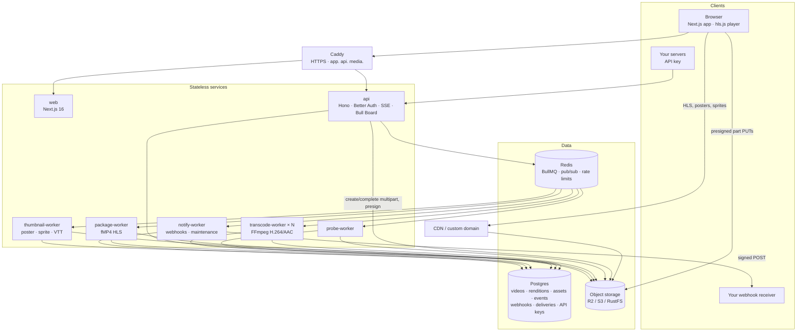
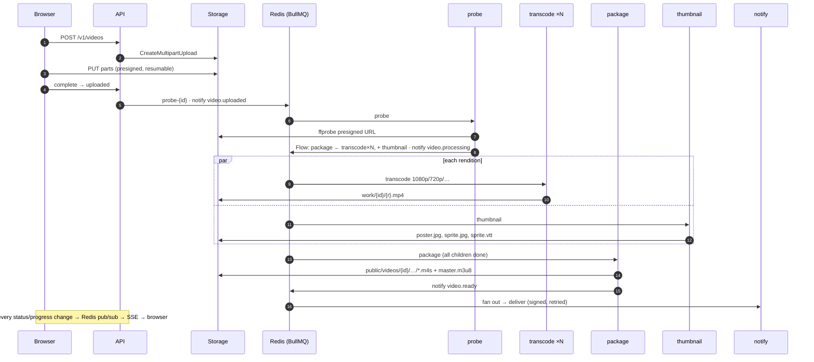
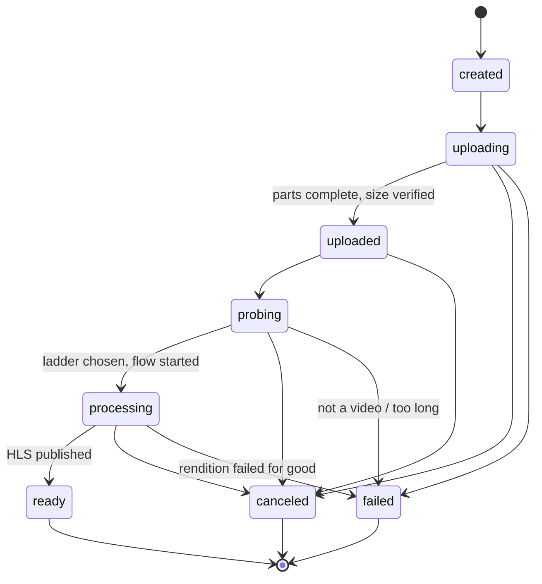

# Vidflow architecture

## A video's journey

## Video states

## Packages

| Package                   | What it holds                                                                                                          |
| ------------------------- | ---------------------------------------------------------------------------------------------------------------------- |
| `@vidflow/shared`         | Types and zod schemas shared by API and web; `planParts()`                                                             |
| `@vidflow/db`             | Drizzle schema, migrations, video state machine, repositories                                                          |
| `@vidflow/storage`        | `StorageProvider`, S3 implementation, key layout, bucket setup                                                         |
| `@vidflow/queues`         | Queue contracts, `Pipeline` (flows, cancel, dead letters), typed workers, live pub/sub, rate limiter, autoscale policy |
| `@vidflow/media`          | ffprobe, FFmpeg runner, H.264 args, ladder, HLS, thumbnails                                                            |
| `@vidflow/observability`  | pino logger, Prometheus metrics, worker instrumentation                                                                |
| `@vidflow/worker-runtime` | Wiring shared by media workers                                                                                         |
| `@vidflow/test-utils`     | Real-infrastructure test context, video fixtures                                                                       |

## Key decisions

| Decision                                | Why                                                  | Chapter |
| --------------------------------------- | ---------------------------------------------------- | ------- |
| Bytes never pass through the API        | Presigned uploads in, CDN out; the API stays small   | 3, 4    |
| One queue per stage                     | Each stage scales and fails on its own               | 5       |
| BullMQ Flow for transcode → package     | Fan-in enforced by Redis, not by polling             | 5       |
| Deterministic job IDs                   | Exactly-once enqueue without locks                   | 5       |
| Probe before encoding                   | Bad files fail in seconds; ladder never upscales     | 6       |
| Fixed 2 s GOP, scene-cut off            | Segments align across renditions: seamless switching | 7, 8    |
| Encode MP4, then segment with `-c copy` | Packaging retries never re-encode                    | 8       |
| Measured `BANDWIDTH`, probed `CODECS`   | Players choose qualities they can actually play      | 8       |
| Thumbnails outside the flow             | Cosmetic work never blocks playback                  | 9       |
| Repository change hook → pub/sub → SSE  | Live UI without polling; one place to publish        | 10      |
| Webhook delivery = its own job          | Per-endpoint retries; SSRF guard at connect time     | 10      |
| Dead letters + stall detection          | Nothing fails silently; dead workers' jobs recover   | 12      |
| Queue depth as a metric                 | Drives alerts, dashboards and autoscaling            | 13, 14  |
