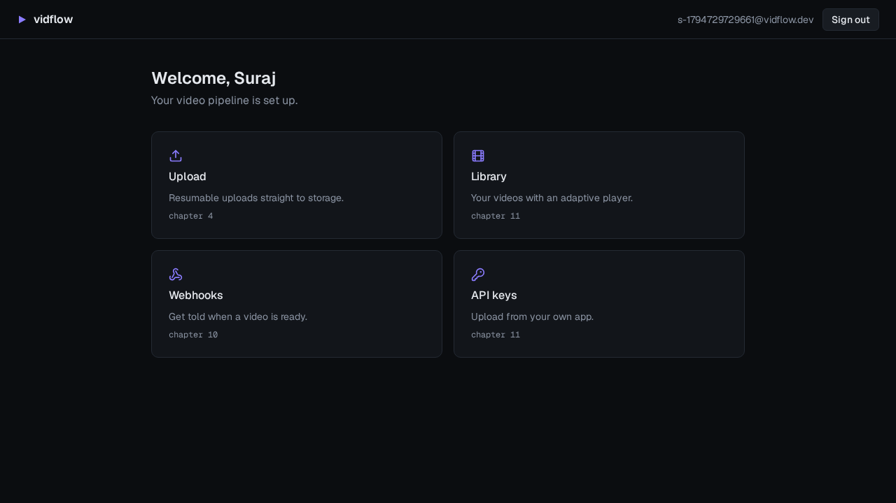

# Chapter 1: Project init and authentication setup

**Goal:** a monorepo where a user can sign up, sign in, see a protected
dashboard and sign out, with format, lint, typecheck, tests and build in CI.

## What you get

- Turborepo + pnpm monorepo: `apps/api`, `apps/web`, `packages/shared`, `packages/tsconfig`
- Hono API with `/health`, Better Auth at `/api/auth/*`, `GET /v1/me`, `AppError` JSON errors
- Next.js 16 web app: sign-up, sign-in, protected dashboard, sign-out, `proxy.ts` redirects
- Dark design system with a violet accent and a play-button wordmark
- Shared zod schemas for the auth forms
- `pnpm smoke`: starts the built API and checks `/health` (also in CI)
- Explicit peer dependencies (`autoInstallPeers: false`) from day one



## Run it

```bash
cp .env.example .env    # set BETTER_AUTH_SECRET: openssl rand -base64 32
docker compose up -d
pnpm install && pnpm db:migrate && pnpm dev
```

[IMPLEMENTATION](IMPLEMENTATION.md) · [ARCHITECTURE](ARCHITECTURE.md) ·
[TESTING](TESTING.md) · [PR_REVIEW](PR_REVIEW.md) · [REBUILD_PROMPT](REBUILD_PROMPT.md)

**Next:** Chapter 2, database and ORM layer.
