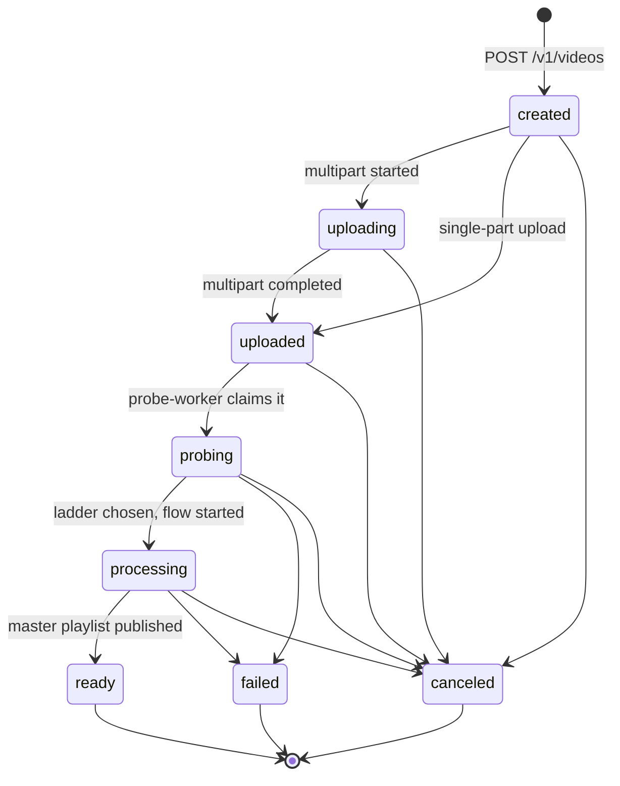

# Video lifecycle (Chapter 2)

`VideoRepository.transition(id, to)` is one conditional `UPDATE … WHERE status IN
(allowedFrom(to))`, so two workers can never both move a video, and a late
worker cannot revive a canceled one.
