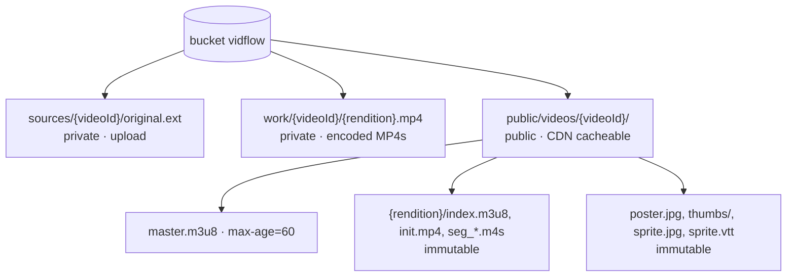

# Bucket layout

| Rule                        | Where                                                 |
| --------------------------- | ----------------------------------------------------- |
| Anonymous GET on `public/*` | Bucket policy (RustFS/S3) or R2 custom domain         |
| Browser PUT parts, see ETag | CORS rule for `WEB_URL`                               |
| Abandoned uploads removed   | Lifecycle: abort incomplete after 1 day on `sources/` |
| Delete a video              | `keys.allPrefixes(id)` → `deletePrefix` (Chapter 12)  |
