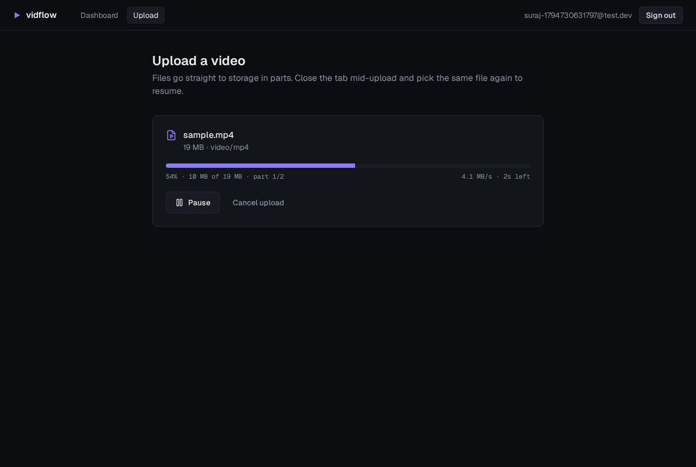

# Chapter 4: Resumable direct uploads

**Goal:** upload multi-gigabyte videos from the browser straight to object
storage, survive a closed tab or a flaky network, and never stream video bytes
through the API.

## What you get

- `POST /v1/videos` creates the video and an S3 multipart upload (type and size checked)
- `POST /v1/videos/:id/upload/parts` signs part URLs; `GET /v1/videos/:id/upload` lists parts storage already has
- `POST /v1/videos/:id/upload/complete` checks every part is there and the object is exactly the declared size
- `DELETE /v1/videos/:id/upload` aborts; `GET /v1/videos`, `GET /v1/videos/:id`
- `planParts()` in `@vidflow/shared`: 16 MiB parts, grown to stay under 10,000 parts
- Web `uploadFile()`: 4 parts in parallel, retries with backoff, progress, pause, resume by file fingerprint
- `/upload` page: drag and drop, progress, speed and ETA, pause/resume/cancel, recent uploads

[IMPLEMENTATION](IMPLEMENTATION.md) · [ARCHITECTURE](ARCHITECTURE.md) ·
[TESTING](TESTING.md) · [PR_REVIEW](PR_REVIEW.md) · [REBUILD_PROMPT](REBUILD_PROMPT.md)

**Next:** Chapter 5, queue architecture with BullMQ Flows.
