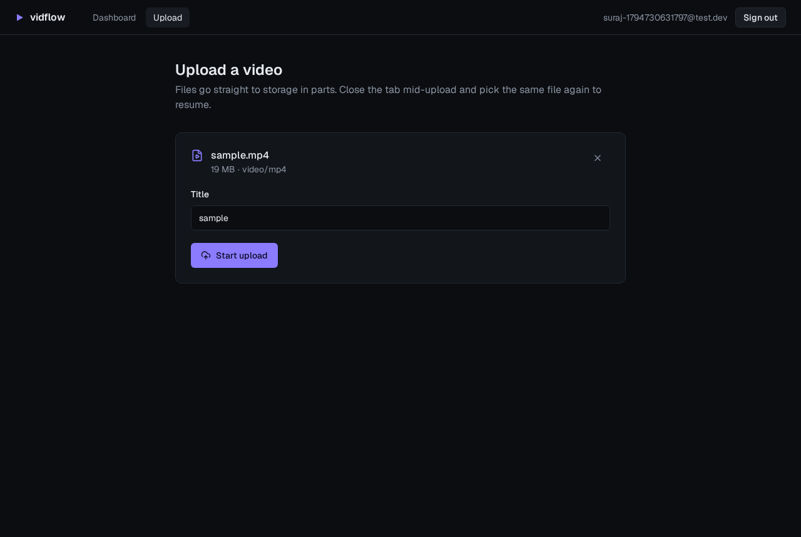
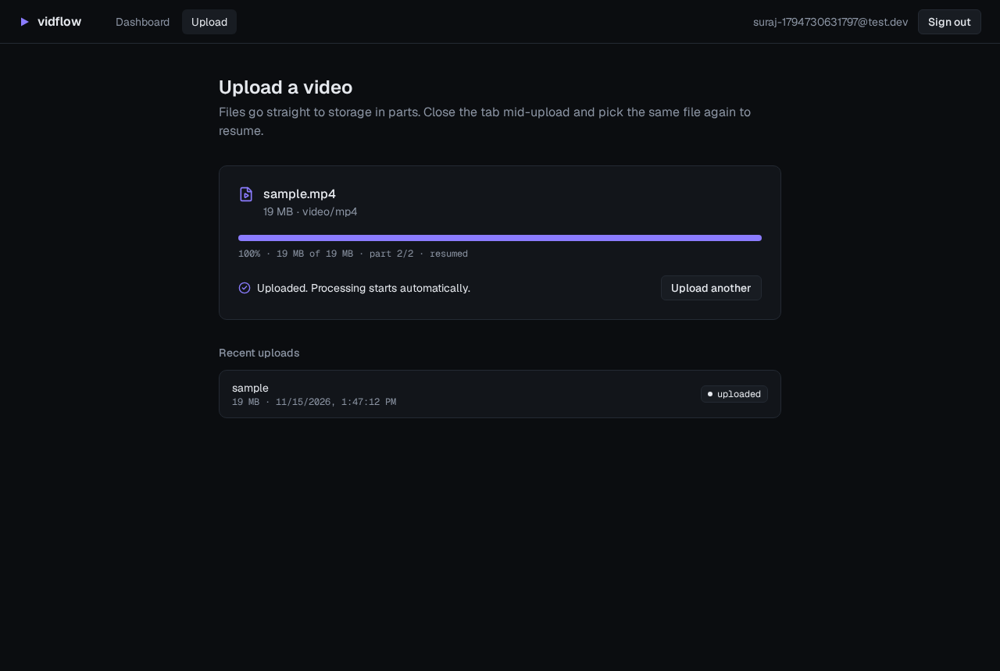

# Chapter 4: Testing

```bash
pnpm test        # shared, api and web unit/integration tests
```

- `packages/shared/src/video.test.ts`: part sizes for small, normal and 500 GiB files; type validation
- `apps/api/test/uploads.test.ts` (real Postgres + RustFS):
  - bad type 400, too large 413, no session 401
  - two-part upload with a "refresh" in the middle: `GET /upload` reports part 1, only part 2 is signed again, complete gives `uploaded`, the object is the right size, `onUploaded` fired
  - completing twice 409; missing parts 400; wrong size fails the video; part past the end 400
  - cancel; other users get 404 and an empty list
- `apps/web/src/lib/upload/uploader.test.ts` (fake IO): full upload, resume skips stored parts, flaky part retried, retry budget exhausted keeps the fingerprint

## Browser

With the stack running (`pnpm dev`), a Playwright script signed up, throttled
uploads to 4 MB/s, uploaded a 19 MB file, paused at ~50%, reloaded the page,
picked the same file, saw "resumed", and finished with status `uploaded`.



