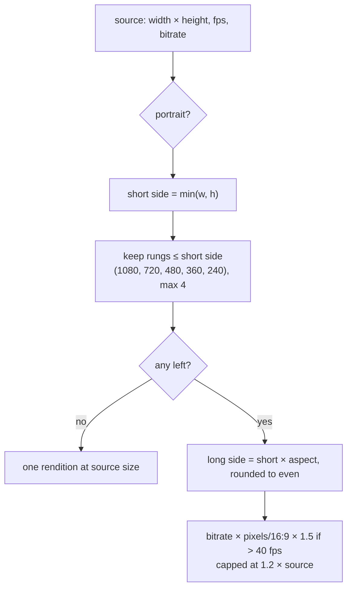

# Rendition ladder

| Source    | Renditions                            |
| --------- | ------------------------------------- |
| 3840×2160 | 1080p, 720p, 480p, 360p               |
| 1280×720  | 720p, 480p, 360p, 240p                |
| 1080×1920 | 1080×1920, 720×1280, 480×854, 360×640 |
| 176×144   | 144p (176×144)                        |
