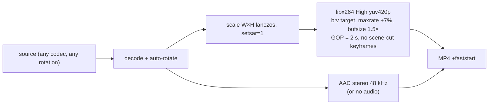

# Encoding settings

| Flag                               | Why                                                          |
| ---------------------------------- | ------------------------------------------------------------ |
| `-g N -keyint_min N`               | Keyframe every 2 s exactly                                   |
| `-sc_threshold 0`                  | No extra keyframes on scene cuts, so renditions stay aligned |
| `-maxrate`/`-bufsize`              | Bitrate peaks stay predictable for adaptive streaming        |
| `-pix_fmt yuv420p -profile:v high` | Plays on every browser and phone                             |
| `-map 0:a:0?`                      | Use audio if present without failing when it isn't           |
| `-movflags +faststart`             | MP4 index at the front: instant progressive playback too     |
| `-reconnect*`                      | Survive dropped connections while reading the source URL     |
