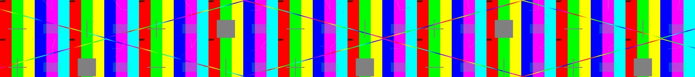

# Chapter 9: Thumbnails and preview sprites

**Goal:** the images every video page needs: a poster that isn't a black first
frame, and a sprite sheet with a WebVTT index for scrub previews. Generated in
parallel with encoding and never able to block playback.

## What you get

- `packages/media`: `posterTimeSec()`, `posterArgs()` (FFmpeg `thumbnail` filter
  skips black and flash frames), `planSprite()`, `spriteArgs()`, `spriteVtt()`
- `apps/thumbnail-worker`: poster, sprite, VTT → `public/videos/{id}/`, `assets` rows
- `posterUrl` on video responses (one query per page)
- Thumbnail failures are logged on the timeline; the video still goes ready



```
WEBVTT

00:00:00.000 --> 00:00:01.000
sprite.jpg#xywh=0,0,160,90
```

[IMPLEMENTATION](IMPLEMENTATION.md) · [ARCHITECTURE](ARCHITECTURE.md) ·
[TESTING](TESTING.md) · [PR_REVIEW](PR_REVIEW.md) · [REBUILD_PROMPT](REBUILD_PROMPT.md)

**Next:** Chapter 10, real-time progress and webhooks.
