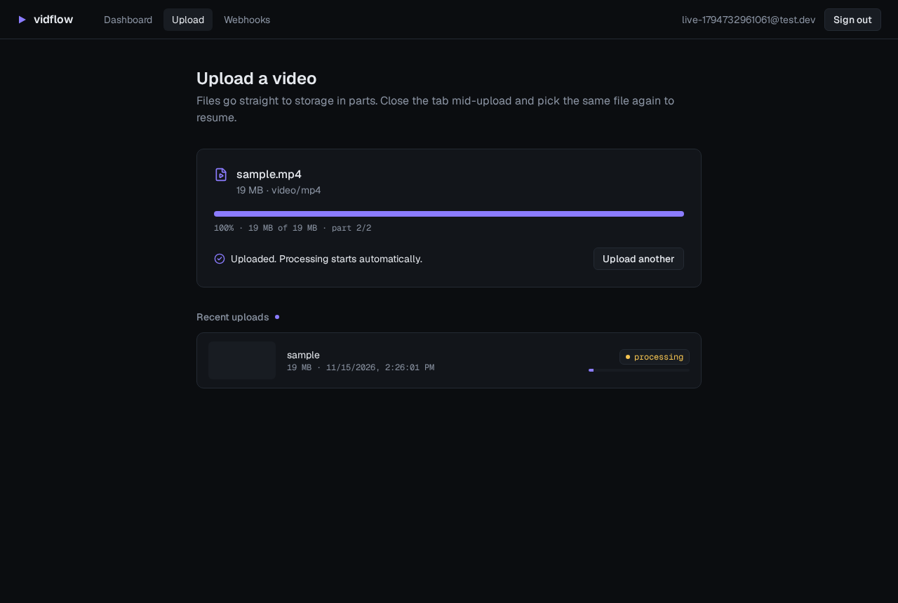
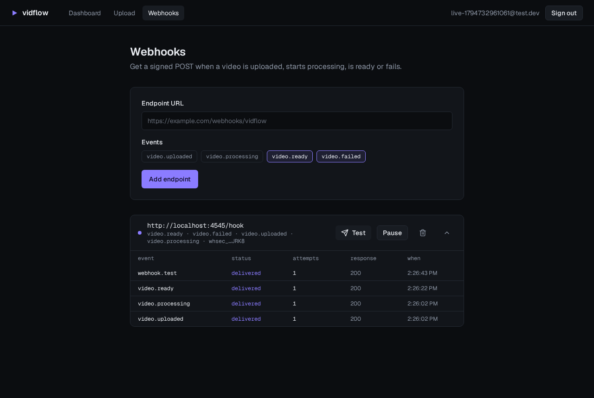

# Chapter 10: Real-time progress and webhooks

**Goal:** tell people what is happening. The dashboard updates live as a video
moves through the pipeline, and other systems get a signed webhook for every
milestone, with retries and a delivery log.

## What you get

- `VideoRepository` `onChange` hook: every status, progress and timeline write is published
- `LivePublisher` (Redis pub/sub, one channel per user, bursts coalesced) and
  `LiveHub` (one subscription per API process, fanned out in memory)
- `GET /v1/live`: server-sent events with heartbeats
- `/v1/webhooks`: create (secret shown once), list, pause, delete, delivery log, test ping
- `apps/notify-worker`: `notify` jobs fan out to one logged delivery per endpoint;
  `deliver` jobs POST with `Vidflow-Signature: t=…,v1=…` (HMAC-SHA256), 8 attempts over ~42 min
- SSRF guard checked on the connected address (defeats DNS rebinding), no redirects
- Events: `video.uploaded`, `video.processing`, `video.ready`, `video.failed`
- `@vidflow/worker-runtime`: shared wiring for every worker
- Web: live status and progress on the upload page, a Webhooks page

[IMPLEMENTATION](IMPLEMENTATION.md) · [ARCHITECTURE](ARCHITECTURE.md) ·
[TESTING](TESTING.md) · [PR_REVIEW](PR_REVIEW.md) · [REBUILD_PROMPT](REBUILD_PROMPT.md)

**Next:** Chapter 11, player and dashboard UI.
