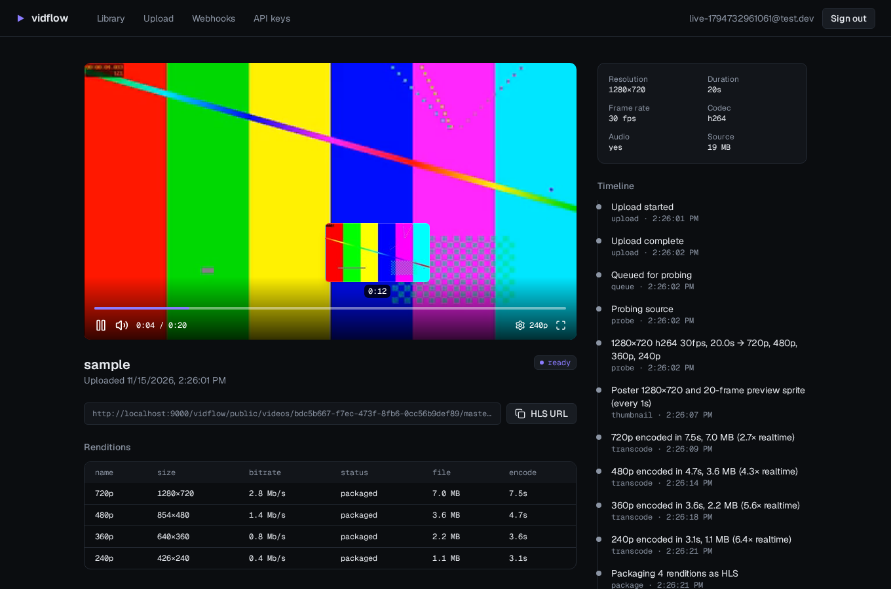
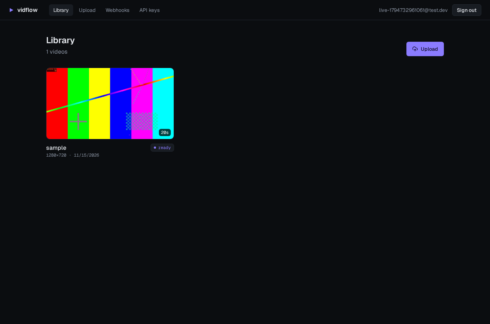

# Chapter 11: Player and dashboard UI

**Goal:** the product people see. A library of videos, a page per video with
an adaptive player (quality menu, scrub previews), the renditions and a live
job timeline, API keys for uploading from servers, and Bull Board for admins.

## What you get

- `VideoPlayer`: hls.js (native HLS on Safari), quality menu with Auto, custom
  timeline with sprite-sheet previews, buffered bar, mute, fullscreen
- `/library`: poster grid with duration, status and live progress
- `/videos/[id]`: player or processing state, HLS URL, renditions table, media
  facts, live timeline
- `/api-keys`: create (shown once), list with last use, revoke
- API: `GET /v1/videos/:id` → `VideoDetail`; `Authorization: Bearer vf_…` on
  every `/v1` route; `/v1/api-keys`; webhooks and keys need a browser session
- Bull Board at `/admin/queues` for `ADMIN_EMAILS`, 404 for everyone else

[IMPLEMENTATION](IMPLEMENTATION.md) · [ARCHITECTURE](ARCHITECTURE.md) ·
[TESTING](TESTING.md) · [PR_REVIEW](PR_REVIEW.md) · [REBUILD_PROMPT](REBUILD_PROMPT.md)

**Next:** Chapter 12, reliability.
