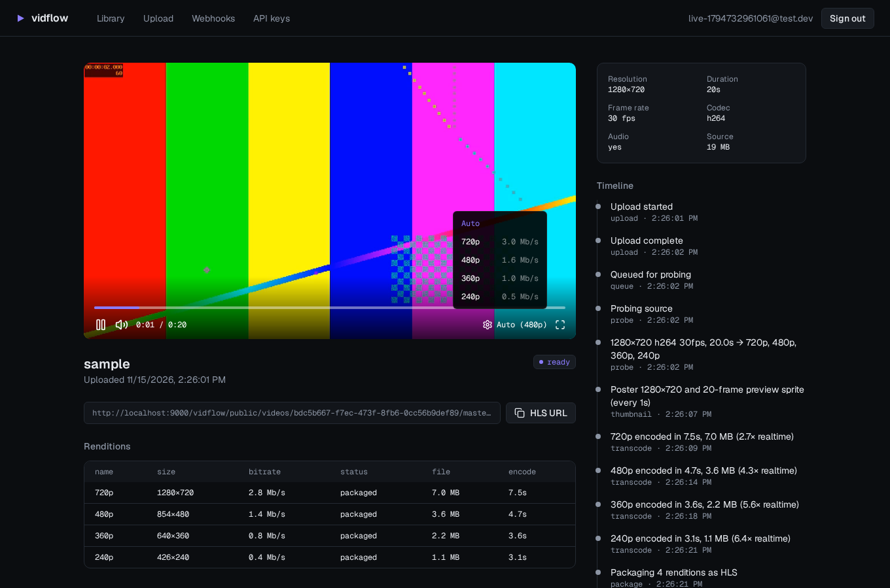
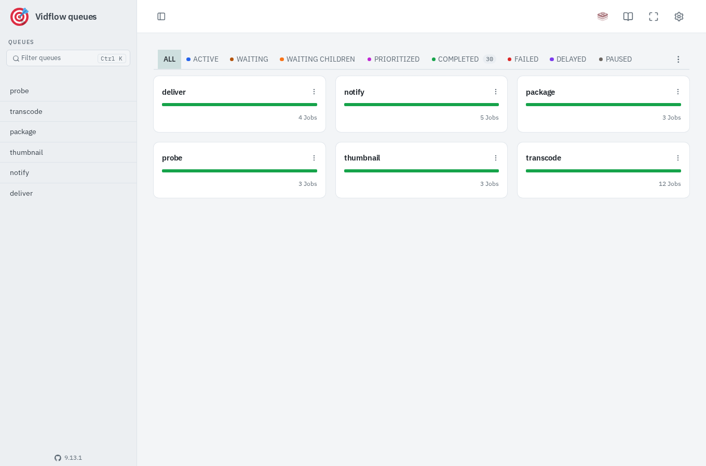

# Chapter 11: Testing

```bash
pnpm --filter @vidflow/api test   # keys, detail, Bull Board gate
pnpm --filter @vidflow/web test   # VTT parsing, uploader
```

- `apps/api/test/api-keys.test.ts`: a key creates an upload that the same user
  sees in the browser with renditions/preview/timeline; keys never listed in full;
  revoked and made-up keys 401; keys can't manage keys or webhooks; another
  user can't revoke; Bull Board 404 without session and for non-admins, 200 for
  an admin with all six queues in its API
- `apps/web/src/lib/vtt.test.ts`: cue parsing with URL resolution, lookup at
  boundaries and past the end

## Browser (production build)

A Playwright run signed in as a user with a ready video:

1. `/library` shows the poster grid
2. the video page plays HLS (`currentTime > 2`)
3. choosing 240p in the quality menu makes `videoHeight` 240
4. hovering 60% along the timeline shows a sprite tile and `0:12`
5. `/admin/queues` opens Bull Board for the admin email



