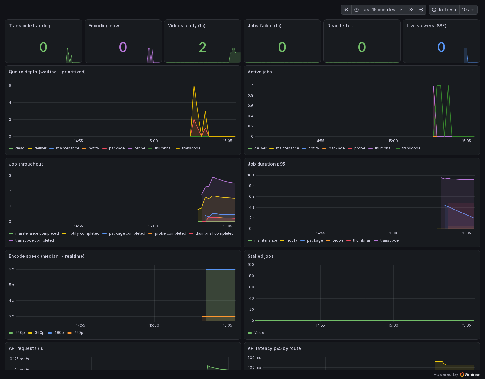

# Chapter 13: Observability

**Goal:** know what the pipeline is doing without reading code: structured
logs from every service, Prometheus metrics for queues, jobs, encodes and the
API, alerts that fire on real problems, and a Grafana dashboard.

## What you get

- `@vidflow/observability`: `createLogger(service)` (pino JSON, secrets
  redacted), `createMetrics(service)`, `instrumentWorker()`, `startMetricsServer()`
- Every worker: JSON logs, `/metrics` and `/health` (Redis reachable) on its own
  port (9465–9469)
- API: request logs, `vidflow_http_requests_total` and latency by route
  pattern, queue depth per queue and state, live SSE connections, uploads;
  `GET /metrics` (optional `METRICS_TOKEN`)
- Encode speed histogram (× realtime) per rendition, stalled-job counter
- `deploy/observability`: Prometheus config, 7 alert rules, provisioned Grafana dashboard

[IMPLEMENTATION](IMPLEMENTATION.md) · [ARCHITECTURE](ARCHITECTURE.md) ·
[TESTING](TESTING.md) · [PR_REVIEW](PR_REVIEW.md) · [REBUILD_PROMPT](REBUILD_PROMPT.md)

**Next:** Chapter 14, deployment, autoscaling and load testing.
