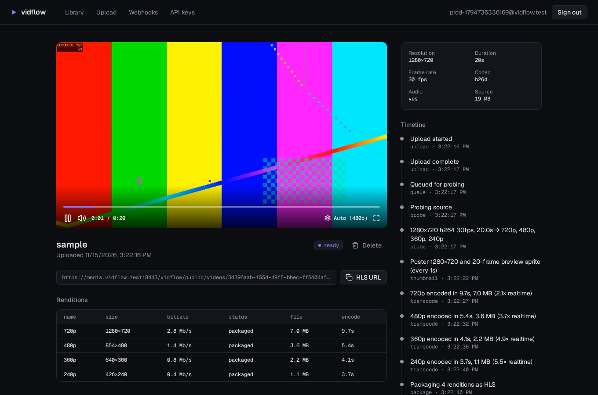

# Chapter 14: Deployment, autoscaling and load testing

**Goal:** ship it. One image per service, a production Compose stack behind
Caddy with HTTPS, Cloudflare R2 (or self-hosted storage), transcode workers
that scale with the queue, and a load test that proves the whole path.

## What you get

- `docker/Dockerfile`: `api`, `web`, five worker targets; healthchecks; `scripts/build-images.sh`
- `docker-compose.prod.yml`: Postgres, Redis (AOF, `noeviction`), a one-shot
  `setup` (migrations + bucket), API, web, workers, Caddy; `storage` profile for RustFS
- `deploy/caddy/Caddyfile`: app/api/media sites, `/metrics` and `/admin` hidden,
  SSE flushed, media host exposing only public reads and presigned uploads
- Storage: `S3_PRESIGN_ENDPOINT` so self-hosted storage can sign browser URLs for its public host
- Cross-subdomain session cookies (`COOKIE_DOMAIN`), standalone Next.js build
- Autoscaling: `desiredReplicas()` policy, `pnpm autoscale` for Compose, KEDA manifest
- `pnpm load-test`; `docs/DEPLOYMENT.md`; final README, `docs/ARCHITECTURE.md`

Production stack, end to end over HTTPS:

Load test (8 × 20 s 720p uploads, 4 concurrent, on a 2-core box):

| Metric            | Value                                |
| ----------------- | ------------------------------------ |
| Ready             | 8 / 8, 0 failed                      |
| Upload p50 / p95  | 1.0 s / 1.1 s                        |
| Time to ready p50 | 79 s                                 |
| Time to ready p95 | 103 s                                |
| Throughput        | 2.8 videos/min                       |
| Autoscaler        | 1 → 3 → 4, back to 1 after 60 s idle |

[IMPLEMENTATION](IMPLEMENTATION.md) · [ARCHITECTURE](ARCHITECTURE.md) ·
[TESTING](TESTING.md) · [PR_REVIEW](PR_REVIEW.md) · [REBUILD_PROMPT](REBUILD_PROMPT.md)
